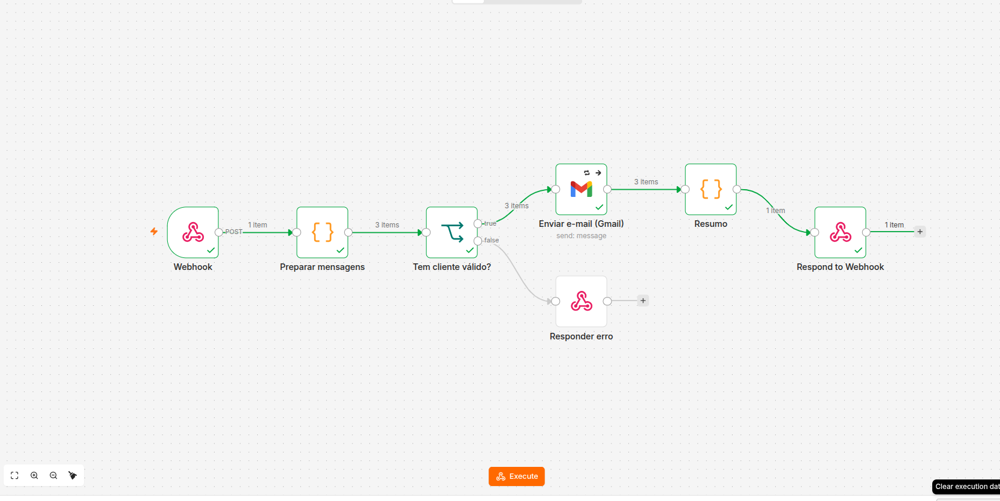
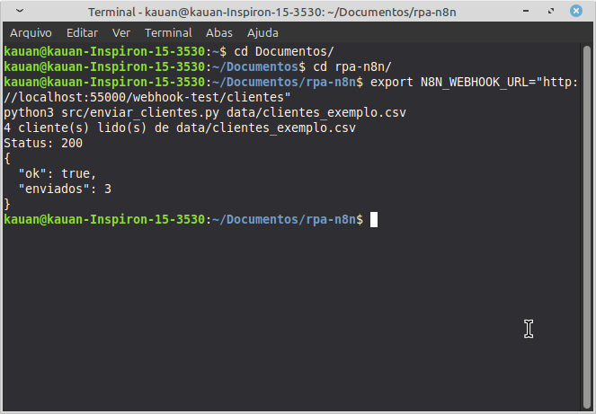

# Assistente de Investimentos com RPA e N8N

Projeto do laboratório "Criando um Processo de RPA com N8N e Python". Um script Python (RPA) lê uma lista de clientes em CSV e envia para um webhook do N8N. O N8N valida os dados, monta uma sugestão de investimento de acordo com o perfil do cliente (conservador, moderado ou arrojado) e envia o e-mail pelo Gmail.

> Os dados de exemplo são fictícios. As mensagens são informativas e educacionais e não constituem recomendação individual de investimento.

## Estrutura

```
.
├── README.md
├── data/clientes_exemplo.csv      # clientes fictícios para teste
├── src/enviar_clientes.py         # script de RPA (Python)
└── n8n/
    ├── workflow_mvp.json          # versão entregue: mensagens por perfil
    └── workflow.json              # extra: mensagens geradas por IA (Gemini)
```

## Como funciona (MVP)

```
CSV -> enviar_clientes.py -> Webhook (POST /clientes)
    -> Preparar mensagens (valida e-mail, define perfil, escolhe o texto)
    -> Tem cliente válido?  -- não --> Responder erro (400)
    -> Gmail (envia)
    -> Resumo -> Respond to Webhook
```

Formato enviado pelo Python ao webhook:

```json
{ "clientes": [ { "nome": "Ana Silva", "email": "ana@exemplo.com", "perfil": "conservador", "saldo": 5000 } ] }
```

## Como rodar

1. No N8N, importe `n8n/workflow_mvp.json`: menu do workflow > Import from file.
2. No nó **Enviar e-mail (Gmail)**, selecione a sua credencial Gmail (OAuth do Google).
3. Clique em **Listen for test event** no nó Webhook e copie a **Test URL**. A porta deve ser a mesma em que o seu N8N abre no navegador.
4. Os e-mails de `data/clientes_exemplo.csv` usam o formato `usuario+ana@gmail.com`, que entrega na caixa de entrada de `usuario@gmail.com`. Troque pelo seu e-mail se necessário.
5. Rode, dentro da pasta do projeto:

```bash
pip install requests
export N8N_WEBHOOK_URL="http://localhost:55000/webhook-test/clientes"
python3 src/enviar_clientes.py data/clientes_exemplo.csv
```

Para uso contínuo, ative o workflow e use a **Production URL** (`/webhook/clientes`).

Resultado esperado: 3 e-mails recebidos (Ana, Bruno e Carla) e o script imprimindo `ok: true` com o total enviado. O cliente com e-mail inválido é ignorado de propósito.

## Decisões técnicas

- **Webhook com "Respond to Webhook".** O script Python fica esperando e recebe um resumo do envio, o que facilita testar e saber se deu certo.
- **Validação logo no início.** Clientes sem e-mail válido são ignorados no nó Code. Se nenhum cliente for válido, o fluxo responde com erro 400 em vez de falhar em silêncio.
- **Perfil padrão "moderado".** Se o perfil vier vazio ou desconhecido, o fluxo assume o perfil intermediário em vez de interromper.
- **Mensagens por perfil.** Cada perfil tem um produto e um texto-base, sempre com linguagem de sugestão e com aviso de que a mensagem é informativa.
- **Retry no Gmail e no Python.** O Gmail tenta até 3 vezes e o script também repete a chamada ao webhook em caso de falha de rede ou erro 5xx.
- **Segredos fora do código.** A URL do webhook vem de variável de ambiente e as credenciais ficam no N8N. Nada sensível vai para o repositório.

## Extra: versão com IA generativa

O arquivo `n8n/workflow.json` acrescenta um nó HTTP Request que chama a API do Gemini para escrever a mensagem de cada cliente. Se a IA falhar, o e-mail sai com a mensagem estática do perfil. Para usar, crie uma credencial **Header Auth** com nome `x-goog-api-key` e a sua chave da API do Gemini, e selecione-a no nó **Gerar mensagem (Gemini)**. Esta versão é opcional e não faz parte do teste principal.

## Próximos passos possíveis

Proteger o webhook com autenticação por header, guardar o histórico de envios em uma planilha, evitar reenvio ao mesmo cliente no mesmo dia, gerar a mensagem com IA (workflow extra) e agendar a execução do script.

## Checklist de entrega

- [ ] Fork do repositório do laboratório e estes arquivos copiados para ele
- [ ] Workflow testado no N8N (prints do fluxo executado, com os nós verdes)
- [ ] E-mails de teste recebidos na caixa de entrada
- [ ] Link do repositório enviado na DIO

## Evidências de teste

**Workflow executado no N8N.** Todos os nós do caminho principal (Webhook, Preparar mensagens, Tem cliente válido?, Enviar e-mail (Gmail), Resumo e Respond to Webhook) aparecem em verde, e o cliente com e-mail inválido foi descartado pelo fluxo.



**Terminal com status 200.** O script `enviar_clientes.py` leu 4 clientes do CSV, enviou ao webhook e recebeu `Status: 200` com `"ok": true` e `"enviados": 3`.


